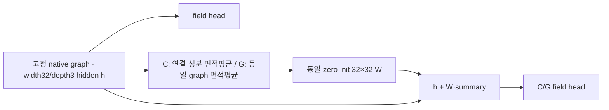

> 원 세션의 2026-10-29 완료 기록 사본입니다. 이 문서의 미게시·다음 실험 표시는 당시 이력입니다. 현재 상태는 [2026-10-30 통합 보고서](INTEGRATION_REPORT_KO.md)를 따릅니다.

# 기존 12개 checkpoint의 공통 a1·Arkkio 평가 완료

2026-10-29. 현재 MotorAI 검토 chat에서 상위 세션의 후속 공통 평가를 이어받아 완료했다. A0/A2/C/G × seed17/29/43 모두 final88565 checkpoint를 사용했고, 각 dev32×45=1,440개, 총17,280개 graph를 새로 추론했다. 새 학습 update·FEA·prior solve는 0이다.

**기존 A2와 C/G 사전등록 판정은 모두 NO_IMPROVEMENT_CLAIM으로 유지한다.** 아래 공극·토크는 공통 연산자 진단이며 새 승패 기준이나 독립 최종시험 결과가 아니다.

## 3시드 평균

nRMSE 단위는 %. 각 seed의 전체 집계 지표를 계산한 뒤 3개를 단순평균했다. 자계는 native 면적가중이며 토크는 1,440개 값의 RMSE/RMS(true)다.

| arm | 전체 B벡터 | 전체 \|B\| | a1 B벡터 | a1 \|B\| | 동일 Arkkio 토크 |
| --- | --- | --- | --- | --- | --- |
| A0 | 20.599303 | 13.617290 | 44.101224 | 34.178979 | 25.052304 |
| A2 | 22.846975 | 14.519389 | 44.301131 | 33.775613 | 30.149830 |
| C | 20.425025 | 13.431054 | 43.264591 | 33.530571 | 29.360715 |
| G | 20.472808 | 13.448874 | 43.022977 | 33.384898 | 33.142780 |

네 arm 모두 a1 B벡터 오차가43–44%다. G는 C보다 평균 a1 B벡터가0.241613pp 낮지만 토크는3.782064pp 높다. 특히 G seed43의 토크 악화13.925371pp를 포함해 세 시드를 모두 보존한다. 공극 오차의 작은 감소가 토크 개선을 보장하지 않았다. 동일 Arkkio 연산은 Br·Bθ의 곱을 사용하므로 공극 |B| 오차만으로 토크 오차를 판단하지 않는다.

## 시드별 결과

| arm / seed | 전체 B벡터 | 전체 \|B\| | a1 B벡터 | a1 \|B\| | 동일 Arkkio 토크 |
| --- | --- | --- | --- | --- | --- |
| A0 / 17 | 20.378967 | 13.504077 | 44.265660 | 34.054610 | 29.470883 |
| A0 / 29 | 20.159737 | 13.289830 | 43.344990 | 33.854626 | 23.159826 |
| A0 / 43 | 21.259203 | 14.057962 | 44.693021 | 34.627702 | 22.526201 |
| A2 / 17 | 22.644157 | 14.523954 | 42.673823 | 32.974510 | 23.995081 |
| A2 / 29 | 24.332195 | 15.128048 | 43.370639 | 33.842388 | 31.272290 |
| A2 / 43 | 21.564574 | 13.906167 | 46.858932 | 34.509941 | 35.182118 |
| C / 17 | 19.896033 | 13.076429 | 43.734627 | 33.142055 | 31.723461 |
| C / 29 | 20.599103 | 13.517684 | 43.152042 | 33.397831 | 31.012770 |
| C / 43 | 20.779938 | 13.699050 | 42.907105 | 34.051827 | 25.345915 |
| G / 17 | 20.406160 | 13.445787 | 43.149974 | 33.509802 | 31.562866 |
| G / 29 | 20.132632 | 13.182123 | 42.374390 | 33.038520 | 28.594186 |
| G / 43 | 20.879632 | 13.718711 | 43.544569 | 33.606374 | 39.271286 |

## 최소·최대와 관측 범위

range=max−min은 관측된 3시드 산술 범위다. 신뢰구간·유의성·동등성 검정으로 해석하지 않는다.

| arm | 지표 | 평균 | 최소 | 최대 | range |
| --- | --- | --- | --- | --- | --- |
| A0 | 전체 B벡터 | 20.599303 | 20.159737 | 21.259203 | 1.099466 |
| A0 | 전체 \|B\| | 13.617290 | 13.289830 | 14.057962 | 0.768132 |
| A0 | a1 B벡터 | 44.101224 | 43.344990 | 44.693021 | 1.348031 |
| A0 | a1 \|B\| | 34.178979 | 33.854626 | 34.627702 | 0.773076 |
| A0 | 동일 Arkkio 토크 | 25.052304 | 22.526201 | 29.470883 | 6.944682 |
| A2 | 전체 B벡터 | 22.846975 | 21.564574 | 24.332195 | 2.767621 |
| A2 | 전체 \|B\| | 14.519389 | 13.906167 | 15.128048 | 1.221881 |
| A2 | a1 B벡터 | 44.301131 | 42.673823 | 46.858932 | 4.185109 |
| A2 | a1 \|B\| | 33.775613 | 32.974510 | 34.509941 | 1.535430 |
| A2 | 동일 Arkkio 토크 | 30.149830 | 23.995081 | 35.182118 | 11.187036 |
| C | 전체 B벡터 | 20.425025 | 19.896033 | 20.779938 | 0.883906 |
| C | 전체 \|B\| | 13.431054 | 13.076429 | 13.699050 | 0.622621 |
| C | a1 B벡터 | 43.264591 | 42.907105 | 43.734627 | 0.827522 |
| C | a1 \|B\| | 33.530571 | 33.142055 | 34.051827 | 0.909772 |
| C | 동일 Arkkio 토크 | 29.360715 | 25.345915 | 31.723461 | 6.377546 |
| G | 전체 B벡터 | 20.472808 | 20.132632 | 20.879632 | 0.747000 |
| G | 전체 \|B\| | 13.448874 | 13.182123 | 13.718711 | 0.536588 |
| G | a1 B벡터 | 43.022977 | 42.374390 | 43.544569 | 1.170179 |
| G | a1 \|B\| | 33.384898 | 33.038520 | 33.606374 | 0.567854 |
| G | 동일 Arkkio 토크 | 33.142780 | 28.594186 | 39.271286 | 10.677100 |

## Paired 차이

왼쪽−오른쪽이 양수이면 오른쪽의 오차가 낮다. 새 공극·토크 차이에 사후 개선 gate를 적용하지 않는다. A0−C/A0−G는 진단 대조이며 새 승자를 선정하지 않는다.

### A0_minus_A2

| 지표 | seed17 pp | seed29 pp | seed43 pp | 평균 pp |
| --- | --- | --- | --- | --- |
| 전체 B벡터 | -2.265189 | -4.172458 | -0.305371 | -2.247673 |
| 전체 \|B\| | -1.019877 | -1.838217 | 0.151795 | -0.902100 |
| a1 B벡터 | 1.591837 | -0.025649 | -2.165910 | -0.199907 |
| a1 \|B\| | 1.080100 | 0.012238 | 0.117761 | 0.403366 |
| 동일 Arkkio 토크 | 5.475802 | -8.112463 | -12.655916 | -5.097526 |

### C_minus_G

| 지표 | seed17 pp | seed29 pp | seed43 pp | 평균 pp |
| --- | --- | --- | --- | --- |
| 전체 B벡터 | -0.510127 | 0.466471 | -0.099694 | -0.047783 |
| 전체 \|B\| | -0.369358 | 0.335561 | -0.019661 | -0.017820 |
| a1 B벡터 | 0.584653 | 0.777652 | -0.637464 | 0.241613 |
| a1 \|B\| | -0.367747 | 0.359312 | 0.445454 | 0.145673 |
| 동일 Arkkio 토크 | 0.160595 | 2.418583 | -13.925371 | -3.782064 |

### A0_minus_C

| 지표 | seed17 pp | seed29 pp | seed43 pp | 평균 pp |
| --- | --- | --- | --- | --- |
| 전체 B벡터 | 0.482935 | -0.439366 | 0.479265 | 0.174278 |
| 전체 \|B\| | 0.427648 | -0.227854 | 0.358912 | 0.186235 |
| a1 B벡터 | 0.531033 | 0.192949 | 1.785917 | 0.836633 |
| a1 \|B\| | 0.912555 | 0.456795 | 0.575875 | 0.648408 |
| 동일 Arkkio 토크 | -2.252578 | -7.852943 | -2.819714 | -4.308412 |

### A0_minus_G

| 지표 | seed17 pp | seed29 pp | seed43 pp | 평균 pp |
| --- | --- | --- | --- | --- |
| 전체 B벡터 | -0.027192 | 0.027106 | 0.379571 | 0.126495 |
| 전체 \|B\| | 0.058290 | 0.107707 | 0.339251 | 0.168416 |
| a1 B벡터 | 1.115686 | 0.970601 | 1.148452 | 1.078246 |
| a1 \|B\| | 0.544808 | 0.816106 | 1.021328 | 0.794081 |
| 동일 Arkkio 토크 | -2.091983 | -5.434360 | -16.745085 | -8.090476 |

## 기존 동결 평가의 보조 지표

아래 값은 이번에 새로 만든 gate가 아니라 사전등록 평가의 저장 결과다. 구리 B² bias는 signed %이며 AC 손실이 아니다.

| arm | seen9 B벡터 % | unused36 B벡터 % | 구리 B벡터 % | 구리 B² bias % |
| --- | --- | --- | --- | --- |
| A0 | 18.263645 | 21.143202 | 34.520253 | -8.781476 |
| A2 | 18.552476 | 23.799522 | 32.607946 | -9.113455 |
| C | 17.969487 | 20.994165 | 35.405154 | -6.677134 |
| G | 18.372148 | 20.965307 | 34.841868 | -9.586432 |

사전등록 평균 no-harm: A2−A0는 seen9 +0.288831pp(PASS), 구리 −1.912307pp(PASS), PA≥70 +2.599085pp(FAIL). G−C는 seen9 +0.402660pp(PASS), 구리 −0.563286pp(PASS), PA≥70 +0.303254pp(PASS). 허용 악화는 각각0.5/1.0/1.0pp다. 개별 시드 악화와 평균 통과를 구별하며 모든 시드 값은 HISTORICAL_VERDICTS.json에 보존했다.

## 추가 진단 전체 목록

COMMON_A1_SUMMARY.json에는 all/a1 × 면적가중/비가중 × B벡터/크기의 nRMSE·물리 RMSE(T), seen9/unused36/내부 미학습/마지막4위상, PA≥70/<70, 조건별 토크 평균·ripple·최악조건을 보존했다. 각 조건의 ripple은 서로 다른 조건을 합쳐 계산하지 않았다. 정답 RMS=0인 경우 정규화 지표는 UNDEFINED로 남기고 절대오차를 보존한다.

## 기존 사전등록 판정과 그래프 근거

- A2: A0 평균20.599303%, A2 22.846975%, Δ=−2.247673pp. 최소1pp와2×spread=5.535242pp를 충족하지 못했고, PA≥70 평균 악화 +2.599085pp도 한도1pp를 넘었다. 기계각 A0를 기준으로 유지한다.
- C/G: C 평균20.425025%, G 20.472808%, Δ=−0.047783pp. 최소1pp와2×spread=1.767812pp를 충족하지 못했다. 평균 no-harm 통과를 개선으로 승격하지 않는다.
- 원 graph 표본18/18에서 rotor–stator 경로가 단절됐다. 공유 design/OP 입력은 양쪽에 유지된다. A0의 실제 field 경로는30,594 parameters이며 기존 pooled summary는 field head로 돌아가지 않는다.
- 이 결손을 시험한 C/G는 같은32×32 bias-free projection(1,024 parameters), zero-init, 같은 초기 backbone과 총71,206 parameters를 사용했다. C=연결 성분 내부 면적평균, G=동일 graph 전체 면적평균만 달랐다. whole-graph 평균 전달은 사전등록 개선을 입증하지 못했다.
- C/G는 native edge 연결 복원 실험이 아니다. 단절의 정확도 기여율과 실제 native 경로 복원 효과는 여전히 UNKNOWN이다.

## 후속 계획과 HOLD

기존 요청의 전역 전달 단일축(C/G)은 이미 종료됐다. 그 비교를 반복하거나 A2·G를 새 기준 모델로 채택하지 않는다. 새로 확인한 큰 a1 오차를 직접 시험할 다음 후보는 **A0 기계각/동일 구조에서 공극 손실 배분만 변경하는 L0 대 L05**다. [검토 가능한 계획 JSON](NEXT_SINGLE_AXIS_PLAN.json)은 PROPOSED_HOLD이며 실행 허가가 아니다.

`Lα=(1−α)Lall+αLa1`, α=0 대0.5 한 쌍만 제안한다. 두 손실 모두 원 trainer의 `Σ A·[(ΔBx)²+(ΔBy)²]/(2ΣA)`를 유지하고 La1만 stationary native a1에 제한한다. Lall에도 a1이 들어 있으므로 유효 공극 비중은 α0.5에서 `0.5+0.5q`(q=a1면적/전체면적)다. train328의 q 분포를 target-free로 기록하며 조건별 α 조정이나 계수 탐색은 하지 않는다. E1의 가중5·spectral30을 복사하지 않는다.

실행 전 train328×phase9의 a1 mask/native-ID admission과 α0 loss·gradient·optimizer1-step 원형 일치를 확인해야 한다. 동일 초기 tensor를 묶은 새 두 arm×3seed, width32/depth3·70,182 parameters·phase9/train328·기존 split/Adam/LR·88,565update·final checkpoint를 고정한다. 각도·context·용량·prior·edge·spectral은 함께 변경하지 않는다.

제안 gate는 a1 B벡터의 3시드 Δ≥1pp 및 Δ>2×spread, 평균 악화 all45/seen9≤0.5pp·구리/고PA/동일Arkkio토크≤1pp다. 토크 개선 주장은 토크 자체의 Δ≥1pp 및2×spread를 별도로 충족해야 한다. 모든 수치는 다음 실행 전에 동결해야 하며 현재 결과의 판정을 바꾸지 않는다.

자원 제안은133 worker1, 각train≤2h/eval≤30min, 전체≤16h, engineering GPU≤900s, soft10GiB, retry0이다. 과거C/G worker시간 합8.27h는 병렬 경합을 포함한 참고치라 새 직렬 wall 예측은 profile 전UNKNOWN이다. source/selection/geometry/evaluator/초기상태 hash와 실제UTC마감·PID/create-time·STOP을 실행 전 결합한다. 새 학습은 사용자 HOLD 해제 전 시작하지 않는다. native 연결 후보에는 회전 위치별 유효 연결 근거가 필요하며 임의 edge·invalid a2 loss를 복원하지 않는다. prior/weights/teacher도 별도 admission까지 HOLD다.

## 실행 및 검증

- 동결 plan SHA-256: `0fcac205b8810f7ffece50b343158f187710d2cdb047b0026ea0c9c01c21cc24`.
- 시작 2026-10-29T00:11:44.531842+00:00, 종료 2026-10-29T00:28:38.681476+00:00, batch wall 1014.140s. worker wall 합계 1013.268s.
- host133, 1 worker 순차, 모델당1800s/전체7200s 및 UTC 마감, retry0, STOP/PID+create-time 소유권을 적용했다.
- dev32 native geometry all45 stationarity와 graph native-ID/면적·incidence 결합을 모두 통과했다. 원본의 nonmoving native node 지지와 stationary a1의 약45° 각도 지지를 대조해 multiplier8을 고정했다. 이는 별도 anti-periodic solver 경계조건을 새로 검증했다는 뜻은 아니다.
- 12 checkpoint byte SHA와 CPU strict restore를 확인했다. A0_s17 arm/encoding과 A0_s29 encoding의 역사적 metadata 누락은 원 trainer/plan hash 근거와 함께 명시적으로 보존했다.
- 12개 모두 원 all45/seen9와 마지막 train-dev anchor를 허용차0.0001pp 미만으로 재현했다. 회수 후 JSON sufficient statistics 및 토크1,440값에서 집계를 독립 재계산하고 동일 truth도 대조했다.
- 작은 산출물 50개를 전후 remote inventory와 로컬 SHA/size로 확인했다. a1 예측384 NPZ와 checkpoint는 원격 보존, 로컬 전송0.
- production/evaluator 합성 검사44개 PASS, collector12개 및 JSON 요약기 산술·변조 거부 검사 PASS. 합성 검사는 물리 성능 검증을 대신하지 않는다.

## 실패·수정 이력

실패를 성공 기록으로 덮어쓰지 않았다. Geometry R1은 import dependency 누락으로 raw 접근 전 종료, R2는 case44의 rotor/stator 혼합 각도 support를 stationary sector로 잘못 검사해 종료했다. R3는 원본 nonmoving native node의 각도 지지와 all45 실제 a1 좌표 불변으로 admission을 확인했다. case44에서는 전체 a1 node560개 중 raw moving-node 후보와102개가 겹쳤다. 이 후보 정보를 삭제하지 않고 all45/reference delta=0 근거와 함께 보존했다. 3개 deployment 모두 같은 원래 CPU deadline 아래 수행했고 각 attempt의 자동 retry는0이었다.

평가 bootstrap1은 pythonw/python.exe runtime 불일치로 model worker 시작 전 거부됐다. bootstrap2는 SSH에서 시작한 숨김 process가 receipt 없이 종료했으며 원인은 확정하지 않았다. bootstrap3은 고정 python.exe를 사용하는 한 번 실행하는 Windows task로 성공했다. 앞선 두 번의 scientific worker 시작은0이며, 실제12개 모델은 각1회만 평가했다.

최종 회수의 첫 inventory 조회는 Windows SSH의 command 길이 제한으로 로컬 회수 폴더 생성 전에 실패했다. 동일 읽기 전용 query를 stdin으로 전달하도록 transport만 수정해 회수했다. 원격 파일·평가 코드·결과를 수정하거나 모델 평가를 재실행하지 않았다.

## 해석 범위

dev32는 E1 oldTRAIN에 노출된 innerdev다. E1 legacy6의4.9563% 공극/3.2146% 토크와 같은 시험으로 순위를 매기지 않는다. 이번 torque truth는 저장 B에서 동일 Arkkio 연산자로 계산했으며 native solver의 별도 토크 리포트나 실측 검증이 아니다. AC 손실, 독립 일반화, virtual-work torque 성과로 확대하지 않는다. reserved/aliases 및 old val/test 원자료 제외, exact cross-solver bridge0을 유지했다.

원본 사전등록·판정은 canonical 연구 저장소의 performance_diagnosis_20261028 및 next_improvement_20261028에 보존돼 있다. 이 후속 산출물은 현재 chat workspace에만 저장했으며 Git commit/push는 하지 않았다.
