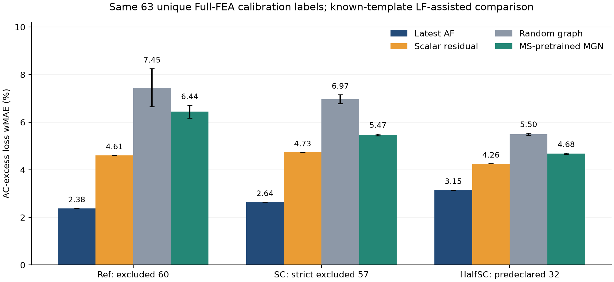

# FE 메시 MGN 구축·동일 Full-FEA 예산 비교

2026-10-27 직접 후속 지시에 따른 추가 기법 연구다. 기존 연구 종료 시각과 자동화 중단을 해제한 캠페인이 아니다. 원고, 회신, 승인 AF 계수, 과거 solver 결과는 수정하지 않았다.

**실제 FE 메시 MGN 학습과 63점 예산 비교를 완료했다. 이번 MGN 구성은 최신 AF보다 정확하지 않았다.** Ref_P117의 주기·시간 간격·메시 수렴은 새로 분리한 계산으로 확인하며, 그 결과는 모델 비교에 사용한 동결 P2 정답을 바꾸지 않는다.

## 같은 예산에서의 결과

모든 방법의 독립 Full-FEA 보정 예산은 Ref36+SC27=63조건이다. SC의 Ref 도너 의존성도 이 63점에 포함한다. HalfSC 보정은 0점이다. 그래프 방법은 세 시드의 평균±표준편차이며, 좋은 시드를 골라 보고하지 않았다.

| 평가 집합 | 최신 AF × canonical Hybrid | scalar 잔차 | 무작위 그래프 대조군 | MS 사전학습 MGN |
|---|---:|---:|---:|---:|
| Ref 자체 보정 제외60 | 2.381% | 4.609% | 7.455% | 6.445±0.268% |
| SC 자체·전달 좌표 제외57 | 2.643% | 4.732% | 6.967% | 5.471±0.041% |
| HalfSC 사전 선언32 | 3.149% | 4.259% | 5.497% | 4.681±0.022% |

지표는 `100 × sum(abs(pred−Full)) / sum(Full)`이다. SC 자체 보정만 제외한69점, exploratory4점, 시드별 MARE·최대오차도 [전체 평가](evaluation/metrics.json)에 별도로 있다. HalfSC32는 이번 학습·튜닝에서 제외했지만, 과거 QC·AF 평가는 있었으므로 전역적으로 한 번도 열지 않은 최종시험이라고 부르지 않는다.



오차막대는 그래프 모델 3개 시드의 표준편차이며 모집단 신뢰구간이 아니다. 현재 자료는 기준 템플릿1개와 Ref/SC/HalfSC 스케일 파생3개다. 새로운 기준 형상 일반화를 검증한 결과가 아니다.

## 구현과 검증

- 원래 FE 삼각형의 연결 관계를 쓰는 1,377노드·2,191요소·7,124방향 간선 그래프를 구현했다. 기존 36도체 중심 kNN과 다르다.
- Ref MS24의 원시 A에서 얻은 B를 면적 가중으로 노드에 투영해 학습했다. 48차원 특징, 메시지 전달4회, 74,018개 파라미터다. 공간·위상별 특징을 모아 `log(Full/Hybrid)` RBF 잔차를 적합한다.
- 슬롯6개가 균질화된 정지 영역 그래프다. 개별 구리 내부 J, 회전자 이동 경계, 전체 모터의 시간 전개 모델은 아직 구현 범위에 포함되지 않는다.
- 1,800회 학습 후 MS 보류 위상 오차가 높아, Full 평가 전에 [수정 계획](AMENDMENT_02.json)을 고정하고 총18,000회로 늘렸다. 최초 결과와 모든 체크포인트를 보존했다. 최종 평가는 그 뒤 한 번 수행했으며 재튜닝하지 않았다.
- [분할·연결 검사](CONTRACT_TESTS.json) 4개, [체크포인트→특징 재현](CHECKPOINT_REPLAY.json) 3모델, [고정 head 재현](HEAD_REPLAY.json) 10모델×228조건을 통과했다. [일반화 적분 reader](GENERALIZED_READER_CHECK.json)도 기존 P2를 다시 확인했다.

## 재사용 파일

| 파일 | 용도 |
|---|---|
| [REPORT_KO.md](REPORT_KO.md) | 해석, 한계, 다음 연구 판단 |
| [CONVERGENCE_REPORT_KO.md](CONVERGENCE_REPORT_KO.md) | 새 FEA의 주기·시간 간격·메시·전류 판정 |
| [DATA_CONTRACT.json](DATA_CONTRACT.json) | 물리량·단위·배열·모델 범위 |
| [source_manifest.json](source_manifest.json), [sample_shards_manifest.json](sample_shards_manifest.json) | 원천·체크포인트·입력 해시와 위치 키 |
| [observations.csv](observations.csv) | 2,280개 모델 예측. 독립 Full 정답이 아님 |
| [evaluation/predictions228.csv](evaluation/predictions228.csv) | 동일 조건의 동결 Full·Hybrid·AF·모델 예측 |
| [SPLIT_MANIFEST.json](SPLIT_MANIFEST.json), [split_audit.json](split_audit.json) | 63개 보정 ID, 제외 집합, 원천·형상 그룹 |
| [artifacts/](artifacts/) | 가중치·RBF head·특징·학습 이력·작은 FE topology |
| [quality_summary.json](quality_summary.json), [case_queue.csv](case_queue.csv) | 판정과 남은 결손 |

대용량 원시 A/native/VTU와 MS 학습 텐서는 별도 원자료 저장소에 보존한다. 저장소에는 작은 topology·특징·가중치·scalar 파형과 검증 코드를 둔다. 로컬 절대 경로 매핑은 게시하지 않는다. 원시 MS24/Full/HalfSC 계보는 [이전 반환 패키지](../remote_return/desktop-6qivkic_20261027/README_KO.md)를 따른다.

## 실행

저장소 루트에서, Python과 NumPy만으로 고정 head를 재현할 수 있다.

```text
python research/lineup_surrogate_20261027/mgn_development_20261027/reproduce_heads.py --models research/lineup_surrogate_20261027/mgn_development_20261027/artifacts --inference research/lineup_surrogate_20261027/mgn_development_20261027/artifacts/inputs/inference228.json --out head_replay_local.json
```

원자료로 학습을 다시 하려면 별도 CUDA 환경에서 아래 순서로 실행한다. `<...>`는 사용자의 경로로 치환한다. 이미 존재하는 출력 폴더는 자동 덮어쓰지 않는다. 재학습을 하면 과거 동결 평가와 구분되는 새 실험으로 관리해야 한다.

```text
python prepare_data.py --ms <recovered-MS24-root> --out <private-training-data>
python test_contracts.py --data <private-training-data> --report <test-receipt.json>
python train.py --data <private-training-data> --out <new-stage1-output>
python refine.py --data <private-training-data> --initial <new-stage1-output> --out <new-stage2-output>
python checkpoint_replay.py --data <private-training-data> --stage2 <new-stage2-output> --out <replay-receipt.json>
```

위 짧은 명령의 스크립트 경로는 이 폴더 기준이다. CUDA/Python/패키지 버전과 공식 배포 wheel 해시는 [SOFTWARE_MANIFEST.json](SOFTWARE_MANIFEST.json)에 있다. 새 FEA 실행은 [계획](PROTOCOL.json)과 계산 수정 기록을 읽고 전용 입력·작업 경로를 설정해야 한다. 이 패키지의 검증 명령은 solver를 자동 실행하지 않는다.

기존 native 결과의 재적분은 `python read_native_case.py --raw <saved-case-raw> --out <new-audit-folder>`로 실행한다. 격리 PC의 독립 worker 폴더에서 실행할 때에는 이전 반환 패키지의 `field_reader.py`를 reader·runner와 같은 폴더에 복사한다. 실제 실행에 사용한 적분 코드와 교체 전 coordinator는 `execution_sources/`에 보존했다.

Reserved `R1_0199`, `R1_0076`은 모든 학습·튜닝·평가에서 제외했다. 정확한 교차 솔버 bridge는 여전히0개다. 원시 연결·재현 PASS를 형상 일반화, 손실 물리 정확도 또는 전체 자료의 수렴 PASS로 확대하지 않는다.

이 비교가 동결된 뒤 수행한 [별도 A/curl 후속 실험](../mgn_followup_20261027/README_KO.md)은 원래 모델을 변경하지 않는다. 133의 L40S에서 실제 학습했고, 동일 원소 B 지표는15.54%에서12.34%로 낮아졌다. 후속 모델의 Full/HalfSC 재평가는 하지 않았으므로 이 자계 개선을 AC 손실의 AF 우위로 해석하지 않는다. EveryMotor의 실제 E1은`target=B`이며 Je440/480의 보유 현황을 metadata로 재확인한 감사도 후속 폴더에 분리했다.
