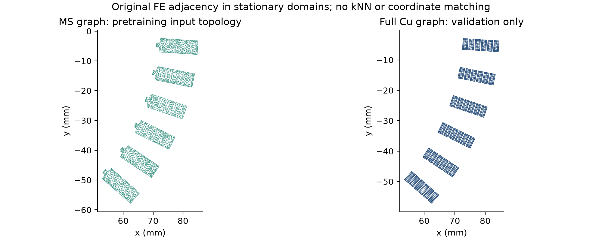
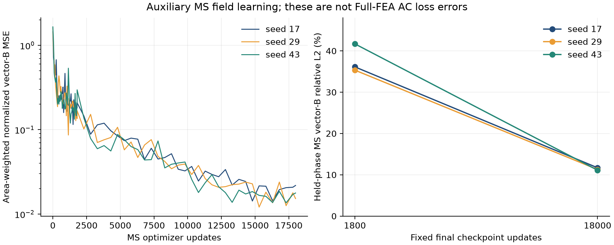

# MS 메시 학습이 AC 손실 예측을 개선했는가

동일한 Full-FEA 보정63점에서, 이번 **MS 사전학습 FE 그래프 특징 + RBF 잔차**는 무작위 그래프 대조군보다 개선됐지만 scalar 잔차와 최신 AF보다 오차가 컸다. 기존 AF를 대체할 근거는 얻지 못했다. 이 결과를 유지하고 평가 후 모델을 재선택하지 않았다.

## 비교의 경계

기준선은 source commit `0034d7c24b1cc0cf41499d028733792b14815bc7`의 동결 exponent separable AF와 동일한 mean-square-field Hybrid다. 계수를 다시 적합하거나 다른 분모에 적용하지 않았다. 기존 원시 복구 commit `4c6ef9325dd0539b0220fb2817782562b9932fb7`의 228행을 사용했다.

Full 보정은 Ref36·SC27, 합계63개 조건이다. SC 도너가 소비한 Ref36을 숨기지 않았다. 전달 예측을 독립 정답으로 늘리지 않았다. 모든 새 head는 같은63개 실제 Full 값만 사용한다. 이보다 많은 필드 배열·위상 샘플이 있어도 Full-FEA 독립 조건 수는63이다.

Ref60, SC strict57은 기존 자체 보정 및 전달 좌표 제외 규칙을 유지했다. HalfSC32의 loss와 field는 학습·사전학습·튜닝에 넣지 않았다. exploratory4는 별도 집계한다. R1 reserved2개와 alias는 전 단계에서 제외한다. MS24는 모두 Ref 원천이며 다른 스케일의 Hybrid와 특징 생성에 재사용된다. 따라서 이 실험은 **알려진 템플릿의 저충실도 자료를 활용한 운전점·스케일 전달**이다. 전체 형상 그룹을 가린 새로운 형상 시험은 아니다.

## 그래프와 학습

MeshGraphNets의 mesh encoder/message passing/decoder 구조를 참고해 순수 PyTorch로 구현했다. 원래 Elmer의 삼각형 간선을 사용하며 1,377노드·7,124방향 간선, hidden48, message passing4회다. 슬롯6개는 서로 분리돼 있고 전체 회전자·이동 경계는 포함하지 않는다. [MeshGraphNets 원 논문](https://arxiv.org/abs/2010.03409)의 일반적인 메시 학습 구조를 채택한 조건부 정지 슬롯 모델이며, 그 논문의 전체 시간 전개 성능을 재현한 것이 아니다.

학습 타깃은 원소의 P1 curl B를 노드에 면적 가중 투영한 벡터 B다. 원시 A→B→canonical Hybrid는 앞선 반환 패키지에서 확인됐다. 이 노드 투영을 canonical 분모 대신 사용하지 않았다. 도체 평균 B, 평균 B의 제곱, B 제곱의 평균은 서로 다른 물리량이다. 현재 MGN의 보조 자계 오차를 Full AC 손실 오차라고 해석하지 않는다.

MGN의 forward 입력은 좌표·슬롯 코드·전류·진각·위상이고, B는 감독값이다. 관측 B를 직접 넣는 encoder와 구분한다. MS로 학습한 조건부 latent를 고정한 뒤 Full63점으로 RBF head를 적합했으며, Full field를 이용해 신경망을 end-to-end 미세조정한 실험은 아니다.

왼쪽의 슬롯6개 그래프가 실제 MS 사전학습 입력이다. 오른쪽은 이번 native 재적분에 연결한 구리36개 영역이다. 오른쪽의 J와 새 수치 해석 결과는 동결 모델 학습에 넣지 않았다. 두 그래프를 좌표 최근접으로 연결하거나 같은 메시라고 선언하지 않았다.

학습에는 Ref24×128위상을 사용한다. 매8번째 위상은 optimizer 배치에서 제외하고 MS 보조 지표만 확인했다. 실제 독립 원천은24개이며, 3,072개의 위상이 3,072개 독립 FEA가 되지는 않는다. Full loss head는 calibration source group을 하나씩 가리는 내부 CV로9개 RBF 후보를 고른다. 각 fold의 정규화와 kernel distance scale은 그 fold의 학습 부분에서만 계산한다. MS 사전학습이 모든24개 저충실도 원천을 보는 사실도 숨기지 않는다.

1,800회 학습의 MS 보류 위상 상대 L2는35.34–41.70%였다. Full 평가를 열기 전에 MS 진단만으로 추가16,200회를 고정했다. 총18,000회 후에는11.11–11.69%, 면적 가중 RMSE는0.0310–0.0327 T였다. 초기·최종 결과를 모두 보존했으며 가장 좋은 시드를 고르지 않았다. 이후 학습은 종료했다.

## 손실 결과의 의미

Ref60+SC strict57을 합친117개 개발 조건에서 wMAE는 AF2.6208%, scalar4.7216%, 무작위 그래프7.0080%, 사전학습 MGN5.5532%다. 큰 SC 손실의 비중이 높으므로 합친 숫자만 사용하지 않고 기계별 결과를 함께 보고한다.

조건별 상대오차도 같은 결론을 보인다. Ref60/SC57/HalfSC32의 MARE는 AF3.22/3.68/4.52%, MGN 시드 평균6.66/10.88/7.77%다. MGN3시드 전체에서의 최대 조건 오차는 각각27.69/33.73/30.99%이며, AF의 최대값14.50/13.42/11.90%보다 크다. 고손실 조건에 가중된 wMAE만으로 저손실 조건의 오차를 숨기지 않는다.

같은 MS 원천을 공유하는 조건을 하나의 군집으로 묶어2,000회 paired bootstrap을 했다. MGN−AF wMAE 차이는 +2.9323 percentage points, 조건부95% 구간은[1.8113,3.9836]이다. HalfSC32에서는 +1.5314 points, 구간[-0.7699,4.5761]이며 원천 군집은8개뿐이다. 이는 이번 원천 군집 내 비교이며 새로운 형상 모집단의 신뢰구간이 아니다.

추가 자계 학습으로 B 지표는 크게 개선됐지만, 합친 개발117점 loss wMAE는 초기5.5385%에서 최종5.5532%로 개선되지 않았다. 자계 MSE 최소화가 AC excess 손실 개선을 보장하지 않는다는 구체적인 관측이다. 현재 표현은 개별 구리의 J 집중과 동적 확산을 직접 학습하지 않고, 공간·위상 특징을 평균·표준편차로 압축한다. 이 정보 손실이 원인인지는 후속 ablation이 필요하며 이번 결과만으로 원인을 단정하지 않는다.

## 계산 비용

RTX3090에서 MS 학습3시드의 첫 단계 합계74.437초, 추가 단계 합계654.813초로 약12.15분이다. 시드당 전체 그래프 가중치는74,018개다. 최고 CUDA tensor 할당량은 약412 MiB, 프로세스 RAM은 약1.2GB였다. 이는 GPU 전체 드라이버·화면 점유 메모리와 다른 지표다.

24개 원천×128위상의 그래프 특징 재생성은 시드당 약1.9초다. 이미 저장한 특징을 사용하는 head만 보면228조건을 ms 이하 또는 약1ms 수준으로 계산하지만, 그래프 인코딩·MS-FEA·canonical Hybrid 생성 시간은 포함되지 않는다. [동일 CPU timing](INFERENCE_TIMING.json)은 AF의 scalar Python 구현과 동일 수식을 벡터화한 NumPy 구현을 함께 보여준다. 빠른 kernel 호출만 근거로 MGN 전체가 AF보다 효율적이라고 주장하지 않는다. AF 과거 보정 시간은 이번에 재측정하지 않았다.

새 Ref_P117 계산3개는 기존 보정점의 수치 민감도용이다. 독립 학습 정답을3개 추가한 것이 아니며 모델별63점 예산에 유리하게 섞지 않는다. 실제 계산 시간과 수렴 판정은 별도 수렴 보고서를 따른다.

## 재현과 물리 검증의 구분

네트워크의 노드 순열 등변성, 원래 FE triangle adjacency, 보호 집합·63점 budget, fit-only 정규화를 검사했다. 저장된 checkpoint3개로 특징을 다시 계산한 최대 차이는4.77e-7이다. 고정 head10개×228조건은 NumPy 환경을 바꿔도 지정된 상대1e-10·절대1e-8 W 허용오차 조합 내에서 재현됐다. 가장 큰 절대 차이는5.4e-6 W이며 큰 예측값의 상대 허용오차가 적용된다.

새 길이 일반화 적분 reader로 기존 Ref_P117 512스텝의 P2 Joule/DC/AC를 다시 계산했다. 최대 손실 차이는2.91e-11 W로 기존1e-6 W gate를 통과했다. 이는 새3주기·512step/period 결과를 같은 계산 정의로 읽기 위한 회귀 검증이며, 새 FEA의 수렴 자체를 미리 통과시킨 것은 아니다.

## 다음 개발에 필요한 것

이번 graph의 원시 연결은 MS24에서 확보됐지만, Full Cu J와 topology가 같은 형태의 다중 형상 학습 자료는 부족하다. 새 기법은 AF×Hybrid를 보존한 추가 잔차, harmonic/mean-square 손실 관련 자계 목적함수, 실제 Cu 내부 J 적분 제약을 후보로 삼을 수 있다. 이들은 아직 검증된 개선안이 아니다.

동일한 Full 예산으로 다중 소스·Field 전이를 과학적으로 비교하려면 형상·재료·결선·파형이 검증된 공통 물리 형상과 운전점을 먼저 확보해야 한다. Motor-CAD/GetDP와의 exact bridge는0개다. 슬롯 깊이, round/chamfer 모서리, 절연·스택·전도도 readback, 운전점 차이가 남아 있으므로 같은 R1 이름으로 병합하지 않는다.

현재 HalfSC32는 모델 비교에 이미 사용됐다. 이후 이를 보고 구조를 바꾼 모델의 새 최종시험으로 재사용하지 않는다. 새 기준 템플릿 전체를 가린 시험 또는 새로 사전 선언한 독립 조건이 필요하다. 예약 형상2개는 계속 제외한다. 원시 Full192/HalfSC36의 모든 조건이 이번 한 앵커의 수렴 결과로 일괄 검증되는 것도 아니다. 구체적인 결손과 계산 한도는 case_queue.csv에 남긴다.

같은 날 수행한 A/curl 개선은 [별도 후속 기록](../mgn_followup_20261027/README_KO.md)에 있다. 위 동결 Full 결과와 체크포인트는 그대로 유지한다. 후속 연구는 MS 표현 손실과 calibration63 내부 CV까지 확인했으며, 이미 열린 HalfSC를 다시 점수화하거나 새 최종시험이라고 부르지 않았다.
