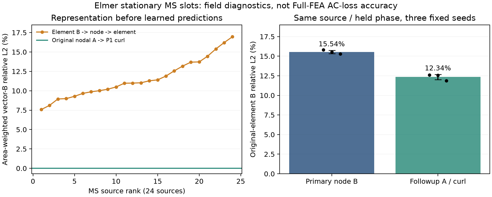

# A/curl MGN 후속 개발과 133 서버 실행

**133 서버에서 A/curl MGN 3개 seed 학습을 완료했다. 같은 원소에서 평가한 MS 자계 오차는 15.54±0.22% → 12.34±0.34%로 감소했다. AC 손실에서 최신 AF를 넘었다는 결론은 아직 없다.**

이 실험은 [앞선 동결 비교](../mgn_development_20261027/README_KO.md)의 Full 평가가 열린 뒤 수행한 별도 개발이다. 그 모델·예측·AF 계수를 바꾸지 않았고 HalfSC를 다시 평가하거나 좋은 seed를 선택하지 않았다. Full 보정 예산은 같은 Ref36+SC27=63조건이며 reserved R1_0199/R1_0076+alias는 계속 제외된다.

## 확인한 원인과 변경

Elmer MS24의 원소 B를 노드에 면적 가중 투영한 뒤 원소로 되돌리면 7.575–16.961%의 표현 오차가 발생했다. 원시 노드 A의 P1 curl은 원소 B와 최대1.11e-14T 차이로 일치했다. 이는 수치 연산 재현이며 물리 정답의 정확도 판정이 아니다. [표현 감사](REPRESENTATION_AUDIT.json)에24개 원천별 오차와 hash가 있다.

원래 FE 간선과 hidden48·메시지 전달4회를 유지하면서 노드 A를 출력하고 원소의 정확한 curl B로 감독했다. 6개 분리 슬롯마다 A의 면적 가중 평균 gauge를 제거한다. 원시 Elmer A가 확인되었으므로 정규화 A 오차도0.1 가중치로 더했다. 파라미터73,969개, batch8, seed17/29/43, 각각18,000updates의 고정 최종 가중치를 사용한다. [사전등록](PROTOCOL.json)에 구조·스케줄·예산·종료 규칙이 있다.

| 같은 원소·같은 MS 보류 위상의 상대 L2 | seed17 | seed29 | seed43 | 평균±표준편차 |
|---|---:|---:|---:|---:|
| 앞선 node B 모델의 원소 복원 | 15.817% | 15.528% | 15.288% | 15.544±0.216% |
| 새 A/curl 모델 | 12.604% | 12.566% | 11.863% | 12.344±0.341% |



앞선 보고서의11.11–11.69%는 **노드에 투영한 B**를 기준으로 측정했으므로 위 표와 직접 비교하지 않는다. 이 표에서는 두 방법 모두 원래 **원소 B**를 기준으로 다시 평가했다. 원소 지표의 평균 차이는 약3.20 percentage points다. 출력 지지 위치·A 보조 손실도 달라져 curl 하나만의 독립 효과를 분리한 ablation은 아니다.

Full63으로 적합한 RBF head의 선택용 source-group 내부 CV wMAE는2.321/2.282/2.145%다. **이 값은 hyperparameter를 선택한 개발 CV이며 AF의 보정점 제외 성능과 비교할 수 없다.** 후속 모델의 Full 평가·HalfSC 재평가는 실행하지 않았다. 자계 개선이 손실 개선으로 이어지는지는 별도로 동결한 시험이 필요하다.

## 실행·검증

HPC133의 L40S에서 별도 Python3.12.10 / PyTorch2.5.1+cu124 환경을 만들었다. 공식 배포에서 앞선 실행에 사용한13개 wheel을 재사용하고 전체 SHA256이 일치함을 확인했다. 학습과 감독 프로세스는 약540초에 정상 종료했고 자동 재시도는0회였다. 기존 AEDT·라이선스 프로세스는 유지됐으며 새 작업의 일회 실행 예약은 완료 후 비활성화했다. 서로 다른 GPU에서 측정한 학습 시간을 모델 효율성의 공정 비교로 해석하지 않는다.

사용자의 종료 시각은2026-10-28 08:00 KST이다. 러너와 감독 프로세스에 UTC 마감과 소유 STOP 검사를 두었으며 완료된 작업을 그 시각까지 불필요하게 재실행하지 않는다. 기존 PAUSED 자동화는 재활성화하지 않았다.

[독립 연산 검증](FOLLOWUP_VALIDATION.json)은 삼각형 방향 반전, 상수 gauge 불변성, float64 gradient check를 통과했다. float32 원시 A→B 재현 최대 오차는1.07e-6T였다. 이는 구현과 부동소수점 검사이며 Full 손실 물리 검증 PASS가 아니다.

기존 EveryMotor는 원본 코드를 읽어 P1 curl 원리를 재사용했다. 실제 E1 checkpoint의 hash와 `target=B`를 확인했고, HDF5 metadata로 v3의 Je 보유440/480을 재확인했다. **E1 가중치나 Motor-CAD Je 정답을 현재 Elmer 학습에 넣지 않았다.** 단위·정의·geometry/OP/alias 대응은 아직 미확정이며 exact cross-solver bridge는0개다. 자세한 근거와 인계 설명 정정은 [EveryMotor 감사](EVERYMOTOR_REUSE_KO.md)를 따른다.

## 재현 파일

`artifacts/`에는3개 신경망 가중치, 고정 latent, RBF head, 학습 이력, 입력·코드 freeze가 있다. `source_manifest.json`과 `split_audit.json`은 원시24개와 동일63개 보정점을 연결한다. 전체 A/B 학습 텐서는 기존 비공개 원자료 저장소에 유지한다.

```text
python prepare_curl_data.py --ms <recovered-MS24> --primary-data <primary-training-data> --out <new-curl-data>
python validate_followup.py --data <curl-data> --primary <primary-checkpoints-and-stage1-INPUT_FREEZE> --curl-run <saved-curl-artifacts> --out <validation.json>
```

학습의 역사적 마감 시각은 코드에 고정돼 있다. 마감 후 재현 검증은 가능하지만 새 학습은 새 승인 범위·시간 계약을 가진 별도 실행으로 관리해야 한다. 보존된 원본 코드와 실험을 덮어쓰지 않는다.

다음 필요한 근거는 손실 관련 mean-square/harmonic 목적함수의 독립 ablation, calibration 조건의 Cu J 원시 적분 연결, 새 조건 또는 새 템플릿을 가린 최종시험이다. 원래 비교의 최신 AF 우위와 공식 수렴 UNKNOWN을 그대로 유지한다.
